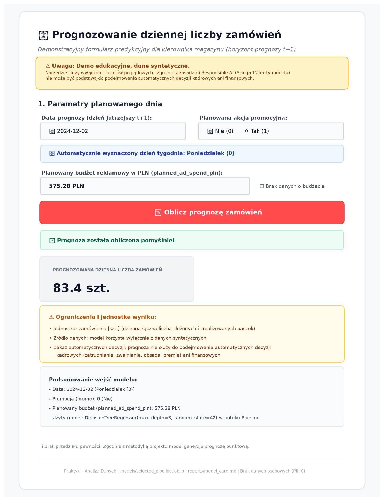

# Praktyki - Analiza Danych i Modelowanie ML

## 📌 Cel i zakres projektu
Celem projektu zrealizowanego w ramach praktyk jest stworzenie powtarzalnego, bezpiecznego i w pełni deterministycznego potoku analizy danych sprzedażowych sklepu internetowego oraz budowy modelu uczenia maszynowego prognozującego popyt na dzień jutrzejszy ($t+1$). Projekt kładzie szczególny nacisk na:
- Inżynierię jakości danych i zasadę *Fail-Fast* w module czyszczącym,
- Ochronę przed wyciekiem danych (*Data Leakage*) w procesie modelowania,
- Zamrożenie potoków produkcyjnych oraz niezależną ewaluację na zbiorze testowym,
- Interaktywne wdrożenie modelu w aplikacji demonstracyjnej Streamlit,
- Rzetelną współpracę i krytyczny audyt generatywnych asystentów AI (Prompt Hygiene).

---

## 📁 Struktura repozytorium

```text
praktyki dane/
├── data/
│   ├── raw/                  # Niemutowalne dane źródłowe (tylko do odczytu: CSV, kalendarz)
│   └── processed/            # Oczyszczone zbiory danych: orders_train.csv, orders_validation.csv, orders_test.csv, orders.sqlite
├── notebooks/                # Notatniki Jupyter (01_start.ipynb, 02_analysis.ipynb)
├── src/                      # Kod źródłowy wielokrotnego użytku:
│   ├── prepare_data.py       # Centralny potok czyszczenia i dołączania kalendarza (Single Source of Truth)
│   ├── query_data.py         # Załadunek bazy SQLite i agregacje analityczne
│   ├── train.py              # Potok cech (ColumnTransformer), trening i zamrożenie modeli
│   └── predict.py            # Niezależne wnioskowanie testowe (.predict) i funkcja predykcji pojedynczego dnia
├── tests/                    # Zautomatyzowane testy jednostkowe:
│   ├── test_prepare_data.py  # 6 prób walidacji danych (ujemne/ułamkowe orders, budżet, data)
│   └── test_training.py      # 3 próby ochrony przed Data Leakage i determinizmu potoku cech
├── models/                   # Zamrożone obiekty produkcyjne (.joblib):
│   ├── baseline.joblib       # Model odniesienia DummyRegressor (stała mediana 85.0 szt.)
│   └── selected_pipeline.joblib # Produkcyjny Pipeline (ColumnTransformer + DecisionTreeRegressor d=3)
├── reports/                  # Raporty analityczne, metryki CSV, audyty i wykresy PNG
├── sql/                      # Zapytania analityczne SQL (queries.sql)
├── app.py                    # Aplikacja demonstracyjna Streamlit do prognozowania popytu na jutro
├── requirements.txt          # Zależności i wersje bibliotek
├── AGENTS.md                 # Wytyczne i zasady współpracy z asystentami AI
├── .gitignore                # Wykluczenia z kontroli wersji Git (.venv, cache, pliki tymczasowe)
└── README.md                 # Główna dokumentacja projektu i instrukcja odtworzenia
```

---

## 📊 Kluczowe wyniki analityczne i raporty

Wszystkie ustalenia analityczne i wyniki modelowania zostały udokumentowane w dedykowanych raportach w katalogu `reports/`:

| Raport / Dokument | Ścieżka pliku | Kluczowe wnioski i zawartość |
|---|---|---|
| **Raport jakości danych** | [reports/quality.md](reports/quality.md) | Tabela *Przed vs Po*, reguły czyszczenia, rachunek różnicy -3 orders, audyt połączenia z kalendarzem. |
| **Raport analityczny (EDA)** | [reports/analysis.md](reports/analysis.md) | Szereg czasowy, analiza dni tygodnia (szczyt w soboty: 105.19 szt.), wpływ promocji (+30.2%), zapytania SQL. |
| **Karta Modelu (Model Card)** | [reports/model_card.md](reports/model_card.md) | Specyfikacja zadania $t+1$, dobór metryki MAE, architektura `ColumnTransformer`, analiza błędów. |
| **Audyt odtwarzalności potoku** | [reports/reproduction.md](reports/reproduction.md) | Weryfikacja tożsamości numerycznej modeli (różnica MAE = 0.0000), kontrola ciągłości kalendarza. |
| **Specyfikacja i testy aplikacji Demo** | [reports/demo_tests.md](reports/demo_tests.md) | 6 prób formularza Streamlit, obsługa braków budżetu, ostrzeżenia o ekstrapolacji powyżej 1500 PLN. |
| **Audyt współpracy z asystentem AI** | [reports/ai_evaluation.md](reports/ai_evaluation.md) | Ewaluacja 6 prób AI, odporność na *Indirect Prompt Injection*, studium błędu Próby 4 i 5 zasad AI. |
| **Tabela kompletności przekazania** | [reports/handover.md](reports/handover.md) | Pełna macierz gotowości komponentów repozytorium do publikacji oraz lista otwartych problemów. |
| **Szkic prezentacji końcowej** | [reports/presentation.md](reports/presentation.md) | 5 sekcji wystąpienia ustnego (7 minut) podsumowujących biznesowy, techniczny i etyczny wymiar praktyk. |

### Kluczowe wykresy i wizualizacje:
- **Szereg czasowy sprzedaży:** [reports/orders_by_date.png](reports/orders_by_date.png) – Dzienny przebieg zamówień z zaznaczeniem okresów promocji.
- **Wpływ dni tygodnia:** [reports/orders_by_weekday.png](reports/orders_by_weekday.png) – Średnia sprzedaż według dni tygodnia (oś Y od zera, szczyt w soboty: 105.19 szt.).
- **Rozkład popytu:** [reports/orders_histogram.png](reports/orders_histogram.png) – Rozkład empiryczny liczby zamówień z medianą i średnią.
- **Wykres poglądowy z uciętą osią:** [reports/orders_by_weekday_truncated_demo.png](reports/orders_by_weekday_truncated_demo.png) – Poglądowy wykres ilustrujący ryzyko manipulacji percepcją różnic.
- **Zrzut ekranu aplikacji demonstracyjnej:** [reports/demo.png](reports/demo.png) – Podgląd interfejsu aplikacji Streamlit z prognozą na jutro.

---

## 🛠️ Środowisko i wymagania wstępne

Instrukcja została przygotowana i zweryfikowana pod kątem systemu **Windows 10 / Windows 11** oraz konsoli **PowerShell**:
- **System operacyjny:** Microsoft Windows 10 / 11 (64-bit),
- **Powłoka:** Windows PowerShell 5.1+ lub PowerShell 7+,
- **Interpreter języka:** Python 3.13 / Python 3.14+ (zainstalowany w systemie i dodany do zmiennej PATH),
- **System kontroli wersji:** Git 2.40+,
- **Środowisko IDE:** Antigravity IDE (lub VS Code).

> **Ważna zasada:** Wszystkie poniższe polecenia Pythona używają bezpośredniej ścieżki do pliku wykonywalnego w środowisku wirtualnym: `.\.venv\Scripts\python.exe`. Dzięki temu nie ma konieczności wcześniejszego uruchamiania skryptu aktywacji powłoki (`Activate.ps1`).

---

## 🚀 Instrukcja uruchomienia krok po kroku (Windows 10 / PowerShell)

Wszystkie polecenia należy uruchamiać w oknie terminala **PowerShell** otwartym w **głównym folderze projektu** (`praktyki dane`):

### Krok 1: Otwarcie projektu w Antigravity IDE
1. Uruchom program **Antigravity IDE**.
2. Wybierz z menu górnego: **File** $\rightarrow$ **Open Folder...** (lub skrót `Ctrl + K, Ctrl + O`).
3. Wskaż folder główny repozytorium: `praktyki dane`.

### Krok 2: Utworzenie środowiska wirtualnego (`.venv`)
* **Katalog roboczy (Cwd):** `c:\Users\Lenovo\Desktop\praktyki dane` (główny folder)
* **Polecenie w PowerShell:**
  ```powershell
  python -m venv .venv
  ```
* **Oczekiwany wynik:** Utworzenie katalogu `.venv/` zawierającego izolowane środowisko Pythona (`.venv/Scripts/python.exe`).

### Krok 3: Instalacja wymaganych bibliotek
* **Katalog roboczy (Cwd):** Główny folder projektu
* **Polecenie w PowerShell:**
  ```powershell
  .\.venv\Scripts\python.exe -m pip install --upgrade pip
  .\.venv\Scripts\python.exe -m pip install -r requirements.txt
  ```
* **Oczekiwany wynik:** Komunikat pomyślnej instalacji pakietów (`Successfully installed pandas numpy scikit-learn matplotlib seaborn streamlit joblib ...`).

### Krok 4: Konfiguracja interpretera i kernela w IDE
1. W Antigravity IDE naciśnij skrót `Ctrl + Shift + P` i wpisz: `Python: Select Interpreter`.
2. Wskaż ścieżkę do środowiska projektu: `.\.venv\Scripts\python.exe`.
3. Przy otwieraniu notatników w prawym górnym rogu upewnij się, że jako **Kernel** wybrano `.venv (Python 3.13/3.14)`.

---

### Krok 5: Przygotowanie i deterministyczne czyszczenie danych
* **Moduł:** [`src/prepare_data.py`](src/prepare_data.py) (Single Source of Truth)
* **Katalog roboczy (Cwd):** Główny folder projektu
* **Polecenie w PowerShell:**
  ```powershell
  .\.venv\Scripts\python.exe src/prepare_data.py
  ```
* **Działanie:** Czyta surowe dane z `data/raw/`, usuwa duplikaty, standaryzuje `promo`, waliduje daty, obsługuje ujemne/ułamkowe zamówienia flagą `orders_invalid = 1` i dołącza kalendarz bez fan-out.
* **Oczekiwany plik wynikowy:**
  - `data/processed/orders_train.csv` (252 wiersze, 248 poprawnych celów),
  - `data/processed/orders_validation.csv` (84 wiersze),
  - `data/processed/orders_test.csv` (84 wiersze).
* **Oczekiwany komunikat konsoli:**
  ```text
  WSZYSTKIE KONTROLE PODZIAŁU CZASOWEGO I TESTU ZAKOŃCZONE PEŁNYM SUKCESEM!
  ```

### Krok 6: Uruchomienie testów jednostkowych jakości danych
* **Moduł testów:** [`tests/test_prepare_data.py`](tests/test_prepare_data.py)
* **Katalog roboczy (Cwd):** Główny folder projektu
* **Polecenie w PowerShell:**
  ```powershell
  .\.venv\Scripts\python.exe tests/test_prepare_data.py
  ```
* **Zakres prób (6/6):** Ujemne `orders` (flaga NaN), niepoprawna data (ValueError), ujemny budżet (ValueError), tekstowy budżet (ValueError), ułamkowe `orders` (flaga NaN), tekstowe `orders` (ValueError).
* **Oczekiwany komunikat konsoli:**
  ```text
  Ran 6 tests in 0.164s
  OK
  ```

### Krok 7: Załadowanie lokalnej bazy SQLite i zapytania agregujące
* **Moduł:** [`src/query_data.py`](src/query_data.py)
* **Katalog roboczy (Cwd):** Główny folder projektu
* **Polecenie w PowerShell:**
  ```powershell
  .\.venv\Scripts\python.exe src/query_data.py
  ```
* **Działanie:** Tworzy tabelę `orders_train` w bazie `data/processed/orders.sqlite`, weryfikuje typy `REAL` i natywne `NULL` oraz generuje tabele podsumowujące.
* **Oczekiwane pliki wynikowe:**
  - `data/processed/orders.sqlite`,
  - `reports/by_promo.csv`, `reports/by_weekday.csv`, `reports/by_month.csv`.
* **Oczekiwany komunikat konsoli:**
  ```text
  [Sukces] Załadowano 252 wierszy z 'orders_train.csv' do tabeli 'orders_train' w 'orders.sqlite'.
  [Sukces] Wszystkie zapytania analityczne i raporty CSV wygenerowane pomyślnie.
  ```

### Krok 8: Eksploracyjna analiza danych w notatniku (EDA)
* **Notatnik:** [`notebooks/02_analysis.ipynb`](notebooks/02_analysis.ipynb)
* **Sposób wykonania:**
  1. Otwórz plik `notebooks/02_analysis.ipynb` w edytorze Antigravity IDE.
  2. Upewnij się, że kernel to `.venv`.
  3. Wybierz opcję **Restart Kernel**, a następnie **Run All**.
* **Działanie:** Weryfikuje zgodność pandas vs SQL za pomocą asercji `assert`, prezentuje tabele i eksportuje 4 oficjalne wykresy do katalogu `reports/`.
* **Oczekiwane pliki wynikowe w `reports/`:**
  - `reports/orders_by_date.png`,
  - `reports/orders_by_weekday.png`,
  - `reports/orders_histogram.png`,
  - `reports/orders_by_weekday_truncated_demo.png`.

---

### Krok 9: Trening potoku uczenia maszynowego i zamrożenie modeli
* **Moduł:** [`src/train.py`](src/train.py)
* **Katalog roboczy (Cwd):** Główny folder projektu
* **Polecenie w PowerShell:**
  ```powershell
  .\.venv\Scripts\python.exe src/train.py
  ```
* **Zasada rygoru:** Uczenie odbywa się przy **ściśle zamrożonej konfiguracji** (`DecisionTreeRegressor(max_depth=3, random_state=42)` z potokiem `ColumnTransformer`). Mediana budżetu (`575.275 PLN`) uczona jest wyłącznie na 248 wierszach treningowych.
* **Oczekiwane pliki wynikowe:**
  - `models/baseline.joblib` (zamrożony DummyRegressor),
  - `models/selected_pipeline.joblib` (zamrożony pełny Pipeline),
  - `reports/metrics.csv` (zestawienie MAE treningu i walidacji),
  - `reports/validation_predictions.csv` (prognozy 84 dni walidacji),
  - `reports/validation_errors.csv` (błędy walidacji).
* **Oczekiwany komunikat konsoli:**
  ```text
  [Sukces] Wszystkie etapy treningu, zapisu modeli i eksportu raportów zakończone powodzeniem!
  ```

### Krok 10: Uruchomienie testów jednostkowych potoku modelowania
* **Moduł testów:** [`tests/test_training.py`](tests/test_training.py)
* **Katalog roboczy (Cwd):** Główny folder projektu
* **Polecenie w PowerShell:**
  ```powershell
  .\.venv\Scripts\python.exe -m unittest tests/test_training.py
  ```
* **Zakres prób (3/3):** Brak wymaganego pliku (FileNotFoundError), bezwzględna blokada zabronionych cech `orders`, `visits`, `revenue_pln` (ValueError – ochrona przed Data Leakage), spójność transformera cech.
* **Oczekiwany komunikat konsoli:**
  ```text
  Ran 3 tests in 0.05s
  OK
  ```

### Krok 11: Niezależna ocena modeli na zbiorze testowym
* **Moduł:** [`src/predict.py`](src/predict.py)
* **Katalog roboczy (Cwd):** Główny folder projektu
* **Polecenie w PowerShell:**
  ```powershell
  .\.venv\Scripts\python.exe src/predict.py
  ```
* **Kluczowa zasada audytowa:** Skrypt wczytuje zamrożone modele z `models/` i wykonuje **wyłącznie wnioskowanie predykcyjne (`.predict()`)**. Moduł pod żadnym pozorem nie zawiera wywołania `.fit()` ani nie przelicza mediany z danych testowych.
* **Oczekiwane pliki wynikowe:**
  - `reports/test_predictions.csv` (prognozy dla 84 dni testu od 2024-12-02 do 2025-02-23),
  - `reports/metrics.csv` (uzupełnione o wiersze ewaluacji testowej: Baseline MAE = 17.8452, Drzewo MAE = 14.0930).
* **Oczekiwany komunikat konsoli:**
  ```text
  [Sukces] Pomyślnie zapisano prognozy testowe do 'reports/test_predictions.csv'.
  [Sukces] Zaktualizowano raport metryk w 'reports/metrics.csv'.
  ```

### Krok 12: Uruchomienie interaktywnej aplikacji demonstracyjnej (Streamlit)
* **Plik aplikacji:** [`app.py`](app.py)
* **Katalog roboczy (Cwd):** Główny folder projektu
* **Polecenie w PowerShell:**
  ```powershell
  .\.venv\Scripts\python.exe -m streamlit run app.py --server.address 127.0.0.1 --server.port 8501
  ```
* **Działanie:** Uruchamia lokalny serwer WWW aplikacji demonstracyjnej. Otwórz w przeglądarce adres: **`http://127.0.0.1:8501`**.
* **Funkcjonalności aplikacji:**
  - Wybór dnia tygodnia oraz statusu promocji,
  - Wprowadzenie zaplanowanego budżetu reklamowego (z opcją pozostawienia pustego pola – bezpieczna imputacja medianą treningową 575.28 PLN),
  - Automatyczne ostrzeżenie o ekstrapolacji przy budżecie > 1500 PLN,
  - Widoczny panel ograniczeń i założeń modelu pod wygenerowaną prognozą.
* **Instrukcja i udokumentowane scenariusze testowe:** Szczegółowe przypadki testowe formularza (dzień standardowy, wysoki budżet z ekstrapolacją, brak budżetu) opisano w raporcie [`reports/demo_tests.md`](reports/demo_tests.md).
* **Zrzut ekranu działającego interfejsu demonstracyjnego:**

  

* **Sposób bezpiecznego zatrzymania aplikacji:**
  - Przejdź do okna terminala PowerShell, w którym działa proces, i naciśnij skrót klawiszowy **`Ctrl + C`**.

---

## 🛡️ Rozwiązywanie typowych problemów (Troubleshooting)

### Problem 1: Błędny interpreter Pythona (`ModuleNotFoundError`)
* **Objaw:** Komunikat błędu typu: `ModuleNotFoundError: No module named 'pandas'` lub `No module named 'sklearn'`.
* **Przyczyna:** Uruchomienie polecenia przy użyciu domyślnego, globalnego Pythona systemowego zamiast środowiska wirtualnego projektu.
* **Rozwiązanie:** Zawsze podawaj pełną ścieżkę względną do interpretera w środowisku wirtualnym:
  ```powershell
  .\.venv\Scripts\python.exe <ścieżka_do_skryptu.py>
  ```
  W Antigravity IDE upewnij się, że wybrany interpreter w pasku stanu to `Python (.venv)`.

### Problem 2: Brak pliku źródłowego (`FileNotFoundError`)
* **Objaw:** Komunikat błędu: `FileNotFoundError: Nie znaleziono pliku źródłowego: data\raw\orders_train_raw.csv`.
* **Przyczyna:** Brak wymaganych plików w katalogu `data/raw/` lub uszkodzenie struktury folderów po klonowaniu.
* **Rozwiązanie:** Sprawdź poleceniem `Get-ChildItem data/raw` czy w katalogu znajdują się 4 wymagane pliki wejściowe: `orders_train_raw.csv`, `orders_validation.csv`, `orders_test.csv`, `calendar.csv`. Pliki te są niemutowalne i stanowią podstawę odtworzenia potoku.

### Problem 3: Niewłaściwy katalog roboczy (`Current Working Directory`)
* **Objaw:** Błędy importu modułów (np. `ModuleNotFoundError: No module named 'src'`) lub błędy względnych ścieżek zapisu raportów.
* **Przyczyna:** Terminal PowerShell został otwarty wewnątrz podkatalogu (np. `praktyki dane\src` lub `praktyki dane\notebooks`) zamiast w katalogu głównym projektu.
* **Rozwiązanie:** Upewnij się, że znak zachęty terminala wskazuje główny katalog repozytorium. W PowerShell sprawdź i skoryguj bieżącą lokalizację:
  ```powershell
  Get-Location
  # Jeśli jesteś w podfolderze, przejdź do katalogu nadrzędnego:
  Set-Location "c:\Users\Lenovo\Desktop\praktyki dane"
  ```

---

## 📋 Status weryfikacji i plan odbioru

Zgodnie z wymogami audytowymi projektu:
- **Kroki zweryfikowane lokalnie:**
  - [x] Odtworzenie potoku czyszczenia danych (`src/prepare_data.py`) – 100% zgodne liczności.
  - [x] Zestaw testów jednostkowych walidacji (`tests/test_prepare_data.py`) – 6/6 testów OK.
  - [x] Zapytania bazy SQLite i agregacje (`src/query_data.py`) – 248 dni, suma 20 933.0 szt.
  - [x] Pełne wykonanie notatnika eksploracyjnego (`notebooks/02_analysis.ipynb`) i wygenerowanie wykresów w `reports/`.
  - [x] Trening i zamrożenie modeli produkcyjnych (`src/train.py`, `models/*.joblib`).
  - [x] Testy jednostkowe ochrony przed wyciekiem danych (`tests/test_training.py`) – 3/3 testy OK.
  - [x] Ewaluacja na zbiorze testowym bez wywołania fit (`src/predict.py`) – MAE = 14.0930.
  - [x] Testy funkcjonalne aplikacji demonstracyjnej Streamlit (`app.py`).
  - [x] Opracowanie raportów `reports/handover.md` oraz `reports/presentation.md`.
- **Kroki do sprawdzenia jutro / po publikacji:**
  - [x] Klonowanie repozytorium z publicznego adresu URL do czystego folderu `praktyki-dane-odbior` i test odtworzenia instrukcji krok po kroku (100% numeryczna tożsamość wyników w nowym `.venv`).
  - [ ] Weryfikacja działania odnośników względnych w publicznym interfejsie GitHub.
